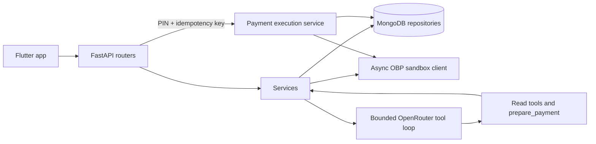

# Clari-Fi backend

Async FastAPI backend for the Clari-Fi finance chat app. It uses MongoDB for app state, Open Bank Project's sandbox for mock accounts and transfers, and OpenRouter for tool-calling chat. A chat tool can create a pending payment draft; only the authenticated transfer endpoint can submit a transfer after PIN verification.

## Project tree

```text
clarifi/
├── app/
│   ├── ai/                 # assistant instructions, tools, sanitization
│   ├── clients/            # OBP, OpenRouter and Tavily clients
│   ├── core/               # settings, auth, errors, logging, Mongo, rate limits
│   ├── repositories/       # user, budget category, and alert persistence
│   ├── models/             # validated API schemas
│   ├── routers/            # auth, users, account, transactions, payments, budgets, alerts, AI
│   ├── services/           # business rules and integrations
│   └── main.py
├── scripts/seed.py
├── tests/
├── .env.example
├── .gitignore
├── Dockerfile
├── README.md
└── requirements.txt
```

## Architecture



## Setup

Use Python 3.11 or newer and MongoDB. Copy `.env.example` to `.env`, then fill in the sandbox and service credentials. `CONSUMER_KEY`, OBP login values, `MONGO_URI`, `JWT_SECRET`, `ENCRYPTION_KEY`, and `OPENROUTER_API_KEY` are required at startup. `TAVILY_API_KEY` is optional.

Generate an app signing secret and a Fernet key:

```powershell
python -c "import secrets; print(secrets.token_urlsafe(48))"
python -c "from cryptography.fernet import Fernet; print(Fernet.generate_key().decode())"
```

The first value goes in `JWT_SECRET`; the second goes in `ENCRYPTION_KEY`. Keep `.env` local; it is excluded by `.gitignore`. `OPENROUTER_MODEL` defaults to `openrouter/free`, which currently routes to a free model matching requested capabilities such as tool calling. You can set a specific model and comma-separated fallbacks if you prefer. See OpenRouter's [free model router](https://openrouter.ai/openrouter/free) and [tool calling guide](https://openrouter.ai/docs/guides/features/tool-calling).

Install and start:

```powershell
python -m venv .venv
.\.venv\Scripts\Activate.ps1
pip install -r requirements.txt
uvicorn app.main:app --reload
```

On startup, Clari-Fi checks the required settings, connects to MongoDB, and initializes collection indexes. OpenAPI docs are at `http://127.0.0.1:8000/docs`.

## Run the React dashboard

The original Figma dashboard is in `C:\Users\RITHIKA\Downloads\clari-fi-—-smart-financial-companion`. Its API client defaults to `http://127.0.0.1:8000/api/v1`; set `VITE_API_BASE_URL` in a frontend `.env.local` only if you move the API. The Vite app runs on port 3000.

Keep two terminals open. Start the backend in this folder:

```powershell
.\.venv\Scripts\Activate.ps1
uvicorn app.main:app --reload --port 8000
```

Start the dashboard in the frontend folder:

```powershell
cd "C:\Users\RITHIKA\Downloads\clari-fi-—-smart-financial-companion"
npm run dev
```

The home page remains available as a local guest preview. To load your live bank-backed account data, sign in or create an account in the dashboard. Account creation also sets the 4-digit payment PIN. Live login, chat, QR/recipient lookup, budgets, alerts, and transfers use the authenticated `/api/v1` endpoints. The backend must have its local `.env` filled in and MongoDB running; the frontend never contains provider secrets.

## Seed sandbox data

Set `DEMO_EMAIL` and `DEMO_PASSWORD` in `.env`, then run:

```powershell
python -m scripts.seed
```

The seed script creates baseline categories and a mock recipient (`9876543210` / `priya@upi`) mapped to the example sandbox recipient account. Change that mapping in `scripts/seed.py` to an account that exists in your OBP sandbox.

## Example requests

Register and set a PIN:

```powershell
curl.exe -X POST http://127.0.0.1:8000/api/v1/auth/register `
  -H "Content-Type: application/json" `
  -d '{"name":"Asha","email":"asha@example.com","password":"change-this-password"}'
curl.exe -X POST http://127.0.0.1:8000/api/v1/users/me/pin `
  -H "Authorization: Bearer <jwt>" -H "Content-Type: application/json" `
  -d '{"pin":"1234"}'
```

Chat can prepare a draft. It cannot execute it:

```powershell
curl.exe -X POST http://127.0.0.1:8000/api/v1/ai/chat `
  -H "Authorization: Bearer <jwt>" -H "Content-Type: application/json" `
  -d '{"message":"Prepare a payment of 650 to 9876543210 for lunch"}'
```

Review the returned `pendingAction.draftId` in the app, then confirm it through the single payment execution path:

```powershell
curl.exe -X POST http://127.0.0.1:8000/api/v1/payments/transfer `
  -H "Authorization: Bearer <jwt>" -H "Content-Type: application/json" `
  -H "Idempotency-Key: <unique-request-key>" `
  -d '{"recipient":"9876543210","amount":650,"note":"Lunch","pin":"1234","draftId":"<draft-id-from-chat>"}'
```

The returned `transactionId` is the ID from the OBP transaction response. OBP sandbox challenges are answered using its documented sandbox TAN value after the user has passed Clari-Fi PIN verification.

## API and safeguards

The backend implements the API contract at `/api/v1`: auth (including logout token blacklist), profile and avatar upload, account overview, transaction list/summary/receipt, recipient lookup/frequent contacts, UPI QR parsing, transfer and draft cancellation, baseline category CRUD, alerts, and AI chat/history. Additive routes are `/api/v1/users/me/pin` and `/api/v1/health`.

Every private route requires a bearer token. Every Mongo query for user-owned content is scoped to the authenticated user. PINs and passwords are bcrypt-hashed; the linked OBP password is Fernet-encrypted. The LLM receives neither credentials nor full account numbers and has no execution tool. Payment drafts expire after ten minutes. Transfers validate the PIN, limits, ownership, recipient and balance, reserve the idempotency key, atomically consume the draft, and only then call the bank. OBP transfer POSTs are not retried after ambiguous failures.

Errors use `{ "error": { "code": "...", "message": "...", "status": 400 } }`; responses include `X-Request-ID` and security headers. Rate limits apply to registration, login, password reset, and AI chat.

## Tests

```powershell
pytest
```

The test suite uses fake/scripted model and bank responses; it does not send real payments. The app itself is configured for the OBP sandbox only.

## Assumptions and open items

- The default OBP recipient account ID in the seed is a sample sandbox mapping; replace it if that account is unavailable in your OBP instance.
- A sandbox challenge is answered with OBP's documented positive test value (`123`) only after Clari-Fi's PIN check succeeds.
- The mock phone/VPA directory must be populated with accounts that exist in the sandbox.
- Monthly growth uses current balance minus this month's net movement as the start-of-month balance; a zero starting balance yields 0%.
- Forgot-password requests return the same public message. In development, the reset token is logged for the hackathon workflow; production email delivery and reset-token consumption are not part of the endpoint contract.
- Avatar files are written to the local `uploads/` directory; use persistent storage when deploying containers.
